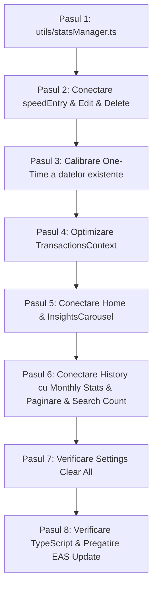

# 🚀 Plan de Optimizare Firestore & Arhitectură Offline-First (Versiune Finală & Detaliată)

Acest document reprezintă ghidul tehnic complet de implementare pentru optimizarea consumului de citiri Firestore, păstrarea performanței offline 100%, garantarea integrității datelor și compatibilitatea totală cu **EAS Update** (fără build nativ nou).

---

> [!IMPORTANT]
> **Compatibilitate Garantată EAS Update (Fără build nativ nou):**  
> Toate modificările folosesc exclusiv pachetele deja existente în proiect (`@react-native-firebase/firestore`, `@react-native-async-storage/async-storage`).  
> **Nu se instalează dependențe native noi și nu se modifică fișierele din `android/` sau `ios/`.** Actualizarea va funcționa 100% prin comanda `eas update`.

---

## 1. Problema Actuală vs. Soluția Nouă

| Funcționalitate | Comportament Actual | Comportament Nou Optimizat |
| :--- | :--- | :--- |
| **Pornire Aplicație** | Descarcă **toate cele 360+ tranzacții** | Citește **1 singur document** (`users/{userId}`) |
| **Carduri Home (Total/Profit)** | Calculat prin `forEach` pe 360 tranzacții | Preluat instant din documentul de statistici |
| **Insights Carousel** | Iterează prin toate tranzacțiile din an | Medii & recorduri calculate matematic / precalculate |
| **History (Luna selectată)** | Filtra din memoria RAM | Citește **1 document lunar** (`monthlyStats/{YYYY-MM}`) |
| **History (Săptămâni 1-4)** | Bucle repetate pentru fiecare săptămână | Balanțe precalculate în interiorul documentului lunar |
| **History (Pe `ALL`)** | 360 tranzacții în RAM | **Lazy Loading real** (`limit(25)` + `startAfter`) |
| **Căutare (Search)** | Căuta în array-ul descărcat la start | **Local Cache First + Verificare Count (1 citire)** |
| **Total Balance la Căutare** | Suma pe tot array-ul | **Sumă exactă pe toate rezultatele găsite** |
| **Funcționare Offline** | Bazată pe cache complet | **100% Offline-First** (SQLite local nativ) |

---

## 2. Structura Noilor Documente de Date (Aggregation Pattern)

Firestore taxează **pe număr de documente citite**, nu pe numărul de câmpuri din document. Structura este concepută pentru a aduce toate datele necesare în **1 singură citire**.

### A. Documentul Utilizatorului (`users/{userId}`)
Conține totalurile de viață și statisticile pentru ecranul Home și Insights Carousel:

```json
{
  "totalIncomeUSD": 14500.50,
  "totalExpenseUSD": 8200.20,
  "totalTransactionsCount": 360,
  "firstIncomeDate": "2026-01-15T00:00:00.000Z",

  "byCurrency": {
    "RON": { "income": 12500.00, "expense": 6200.00 },
    "USD": { "income": 800.00, "expense": 450.00 },
    "EUR": { "income": 0.00, "expense": 100.00 }
  },

  "insights": {
    "avgWeeklyProfitUSD": 145.20,
    "avgMonthlyProfitUSD": 620.50,
    "bestDayEver": {
      "profitUSD": 450.00,
      "date": "2026-08-14"
    },
    "bestWeekEver": {
      "profitUSD": 1250.00,
      "label": "12 May - 18 May"
    },
    "summerProfitUSD": 1850.00
  },
  "statsCalibrated": true
}
```

* **Total Profit:** Se calculează instant în memorie: `totalIncome - totalExpense`.
* **Multi-valută (Garanție Fără Erori de Conversie):**  
  * Când aplicația e pe **RON**, citește direct suma nativă din `byCurrency.RON` $\rightarrow$ **fix 100 RON, fără nicio rotunjire sau aproximare (99.9 sau 100.1)**!
  * Când schimbi pe **USD**, citește valorile din USD.
  * Când schimbi înapoi pe **RON**, revine la valorile originale din `byCurrency.RON`.
  * Funcționează automat pentru orice monedă din lume (INR, GBP, EUR, JPY etc.).

---

### B. Documentul Lunar (`users/{userId}/monthlyStats/{YYYY-MM}`)
Exemplu: `users/{userId}/monthlyStats/2026-10`  
Conține totalul lunii și detaliile fiecărei săptămâni (totul într-un singur document = **1 citire**):

```json
{
  "incomeUSD": 2500.00,
  "expenseUSD": 1100.00,
  "txCount": 24,

  "byCurrency": {
    "RON": { "income": 4500.00, "expense": 1800.00 },
    "USD": { "income": 200.00, "expense": 100.00 }
  },

  "weeks": {
    "0": {
      "incomeUSD": 700.00,
      "expenseUSD": 200.00,
      "count": 6,
      "byCurrency": {
        "RON": { "income": 1200.00, "expense": 400.00 },
        "USD": { "income": 50.00, "expense": 10.00 }
      }
    },
    "1": {
      "incomeUSD": 600.00,
      "expenseUSD": 400.00,
      "count": 8,
      "byCurrency": {
        "RON": { "income": 1500.00, "expense": 600.00 },
        "USD": { "income": 70.00, "expense": 20.00 }
      }
    },
    "2": {
      "incomeUSD": 800.00,
      "expenseUSD": 100.00,
      "count": 4,
      "byCurrency": {
        "RON": { "income": 1100.00, "expense": 500.00 },
        "USD": { "income": 50.00, "expense": 40.00 }
      }
    },
    "3": {
      "incomeUSD": 400.00,
      "expenseUSD": 400.00,
      "count": 6,
      "byCurrency": {
        "RON": { "income": 700.00, "expense": 300.00 },
        "USD": { "income": 30.00, "expense": 30.00 }
      }
    }
  }
}
```

* **Zilele 1-7:** Săptămâna `0` (Week 01)
* **Zilele 8-14:** Săptămâna `1` (Week 02)
* **Zilele 15-21:** Săptămâna `2` (Week 03)
* **Zilele 22-sfârșit:** Săptămâna `3` (Week 04)

---

## 3. Cum funcționează fiecare Ecran în Detaliu

### Ecranul Home
1. **La pornire:** Citește documentul `users/{userId}` (**1 citire**).
2. **Tab-ul TOTAL:** Afișează instant `Total Income`, `Total Expense` și calculează `Total Profit` fără să aștepte nicio tranzacție.
3. **Tab-ul MONTH:** Citește documentul `monthlyStats/{selectedYear}-{selectedMonth}` (**1 citire**). Daily Income/Expense se obține împărțind la numărul de zile din lună.
4. **Tab-ul RANGE:** Interoghează tranzacțiile strict dintre `rangeStart` și `rangeEnd` (de regulă 7 zile, deci ~10 tranzacții).
5. **Insights Carousel:**
   * **Daily Average:** `(totalIncome - totalExpense) / daysElapsed` (zile trecute de la `firstIncomeDate`).
   * **Weekly Average:** Precalculat în `insights.avgWeeklyProfitUSD`.
   * **Monthly Average:** Precalculat în `insights.avgMonthlyProfitUSD`.
   * **Best Day Ever & Best Week Ever:** Luate direct din proprietățile salvate.
   * **Summer Projection (1 Iun - 30 Sep):** Calculat pe baza `insights.summerProfitUSD` și a zilelor rămase.
   * **Saving Rate:** `((totalIncome - totalExpense) / totalIncome) * 100`.

---

### Ecranul History
1. **Pe o lună selectată (ex: Octombrie 2026):**
   * Descarcă documentul `monthlyStats/2026-10` (**1 citire**).
   * Cardul mare de sus arată instant Venitul, Cheltuielile și Profitul lunii.
   * Butoanele `WEEK 01, 02, 03, 04` știu instant dacă au date (`count > 0`).
   * `WEEK BALANCE` se calculează pe loc din `weeks[selectedWeek].incomeUSD - weeks[selectedWeek].expenseUSD`.
   * Lista de tranzacții încarcă doar tranzacțiile lunii curente (`where('dateString', '>=', '2026-10-01')` și `<= '2026-10-31'`).
2. **Pe modul `ALL`:**
   * `TOTAL BALANCE` vine direct din `users/{userId}` (sau filtrat pe income/expense).
   * **Paginare reală (Lazy Loading):**
     * La intrare se descarcă primele 25 de tranzacții (`limit(25)`).
     * Când utilizatorul derulează în jos (`onEndReached`), se descarcă automat următoarele 25 folosind `startAfter(lastVisibleDoc)`.
     * Filtrele `MAX` / `MIN` folosesc `orderBy('amountUSD', 'desc' | 'asc')` direct pe serverul Firestore.

---

### Căutarea (Search) & Verificarea de Concordanță (Cache Reconciliation)
Când utilizatorul apasă pe lupă și caută un cuvânt (ex: „**tur**”):
1. **Căutare Locală Imediată (0 citiri, 0 ms):**
   * Telefonul caută instantaneu în memoria SQLite locală a telefonului.
   * Găsește toate tranzacțiile care conțin „tur” în titlu sau note (ex: 230 de tranzacții).
   * Calculează pe loc **`TOTAL BALANCE` exact pentru toate cele 230 de tranzacții**.
2. **Verificarea de Concordanță (1 singură citire):**
   * Dacă telefonul este online, trimite un apel de tip `count()` către server:  
     `query(collection(db, 'transactions'), where('userId', '==', uid), ...).count().get()`
   * Serverul răspunde cu numărul total de pe server (ex: `count = 230`).
   * **Dacă numărul local este egal cu numărul de pe server (230 == 230):**  
     Aplicația știe că are totul local. Nu mai descarcă nimic!
   * **Dacă numărul local este mai mic (ex: 20 < 230 pe un telefon nou):**  
     Aplicația descarcă automat restul tranzacțiilor din cloud pentru a avea lista completă.
3. **Dacă telefonul este Offline:**  
   * Verificarea cu serverul este ignorată silențios.
   * Se afișează toate datele disponibile local, fără erori.

---

## 4. Tratarea Tuturor Cazurilor Speciale & Edge Cases

### Cazul 1: Editarea unei tranzacții când se schimbă Luna sau Săptămâna
* *Scenariu:* O tranzacție din 5 Septembrie (Luna 09, Săpt 0) este editată pe 12 Octombrie (Luna 10, Săpt 1).
* *Tratare:* `statsManager` scade suma din Luna 09 (Săpt 0) și o adaugă în Luna 10 (Săpt 1). Astfel, ambele luni rămân perfect exacte.

### Cazul 2: Editarea unei tranzacții când se schimbă Tipul (Income <-> Expense)
* *Scenariu:* O tranzacție de 50$ setată inițial ca Income este modificată ca Expense.
* *Tratare:* `statsManager` scade 50$ din `totalIncome` și adaugă 50$ în `totalExpense`.

### Cazul 3: Ștergerea unei tranzacții cu Protejarea Recordurilor (Best Day / Week)
* *Scenariu:* Utilizatorul șterge o tranzacție din istoric.
* *Tratare:*
  1. Șterge documentul din `transactions`.
  2. Scade suma din `users/{userId}` și din `monthlyStats/{YYYY-MM}`.
  3. Scade `totalTransactionsCount - 1` și `txCount - 1`.
  4. **Verificare Recorduri:** Dacă data tranzacției șterse coincide cu data din `bestDayEver` sau `bestWeekEver`, se recalculează recordul real rămas pentru a nu păstra date eronate.
  5. **Verificare Data de Start:** Dacă a fost ștearsă prima tranzacție istorică de venit (`firstIncomeDate`), se actualizează cu următoarea tranzacție de venit rămasă.

### Cazul 4: Ștergerea tuturor tranzacțiilor din Settings (`Clear Transactions`)
* *Scenariu:* Utilizatorul apasă „Clear all transactions” în Settings.
* *Tratare:* Pe lângă ștergerea documentelor de tranzacții, se resetează documentul `users/{userId}` (`totalIncome: 0`, `totalExpense: 0`, `totalTransactionsCount: 0`, `insights: null`) și se șterg documentele din `monthlyStats`.

### Cazul 5: Indecși Composite în Firestore (MAX / MIN pe ALL)
* *Scenariu:* O interogare cu `where('userId', '==', uid)` combinată cu `orderBy('amountUSD', 'desc')` necesită un index compus pe Google Cloud.
* *Tratare:* 
  1. În cod punem un **mecanism de siguranță (Fallback Safe-Guard)**: dacă indexul nu a fost încă creat pe consola Firebase, codul prinde eroarea și ordonează tranzacțiile în memorie sau revine temporar la ordonarea după dată, **fără să crape aplicația**.
  2. Documentăm link-ul direct pentru activarea indexului în Firebase Console dintr-un singur click.

### Cazul 6: Prima pornire după EAS Update (Calibrarea Silențioasă)
* *Scenariu:* Utilizatorul are 360 de tranzacții, dar colecția `monthlyStats` nu există încă.
* *Tratare:* La pornire, se verifică indicatorul `statsCalibrated`. Dacă este `false` sau lipsește:
  1. Aplicația citește o singură dată tranzacțiile existente.
  2. Calculează și creează `users/{userId}` și toate documentele `monthlyStats/{YYYY-MM}`.
  3. Setează `statsCalibrated = true`.
  4. De aici înainte, procesul nu mai rulează niciodată.

### Cazul 7: Exportul de Rapoarte PDF și CSV din Settings
* *Scenariu:* Utilizatorul merge în Settings și apasă „Export PDF” sau „Export CSV”.
* *Tratare:* 
  * Exportul folosește propriul query la cerere (`getDocs`) pe colecția de tranzacții doar în momentul când utilizatorul apasă butonul.
  * **Nu se schimbă absolut nimic**: fișierele PDF și CSV continuă să conțină toate tranzacțiile, la fel de detaliate și exacte ca până acum.

---

## 5. Ce se întâmplă Offline?

1. **La pornire fără internet:**
   * Firestore citește documentul `users/{userId}` din cache-ul local SQLite.
   * Ecranul Home, totalurile și caruselul apar **instantaneu și offline**.
2. **Adăugare / Editare / Ștergere offline:**
   * Când adaugi o tranzacție fără net, Firestore o scrie în baza locală și aplică `increment()` pe documentele de statistici locale.
   * Totalurile de pe ecran se actualizează pe loc.
   * Când telefonul revine online, Firestore trimite automat modificările pe server.
3. **Costul citirilor offline:**
   * **0 citiri taxate în cloud.** Orice citire din SQLite local este gratuită și nelimitată.

---

## 6. Etapele de Implementare Pas cu Pas



### Detalierea Pașilor de Execuție:

* [ ] **Pasul 1: Crearea utilitarului `utils/statsManager.ts`**
  * Include funcțiile atomice: `onTransactionCreated()`, `onTransactionUpdated()`, `onTransactionDeleted()`, `resetUserStats()`.
  * Folosește `FieldValue.increment` pentru scriere atomică offline-friendly.

* [ ] **Pasul 2: Conectarea acțiunilor utilizatorului**
  * [speedEntry.tsx](file:///d:/MoneyTracker/app/(tabs)/speedEntry.tsx) apelează `onTransactionCreated()`.
  * [TransactionOptionsMenu.tsx](file:///d:/MoneyTracker/components/TransactionOptionsMenu.tsx) apelează `onTransactionUpdated()`.
  * Ștergerea din [history.tsx](file:///d:/MoneyTracker/app/(tabs)/history.tsx) apelează `onTransactionDeleted()`.
  * [settings.tsx](file:///d:/MoneyTracker/app/(tabs)/settings.tsx) apelează `resetUserStats()` la "Clear Transactions".

* [ ] **Pasul 3: Calibrarea unică inițială (One-time migration)**
  * Funcție auto-executabilă care creează structura inițială din cele 360 de tranzacții și marchează `statsCalibrated = true`.

* [ ] **Pasul 4: Refactorizare `TransactionsContext.tsx`**
  * Elimină interogarea masivă `onSnapshot` de pe întreaga colecție `transactions`.
  * Ascultă doar documentul `users/{userId}` (1 document).
  * Oferă noile statistici către restul aplicației.

* [ ] **Pasul 5: Adaptare `home.tsx` & `InsightsCarousel.tsx`**
  * Înlocuiește calculele repetitive din `home.tsx` cu citirea valorilor precalculate din `userStats` și `monthlyStats`.
  * Actualizează `InsightsCarousel` să consume statisticile direct.

* [ ] **Pasul 6: Adaptare `history.tsx`**
  * Header-ul lunii și săptămânile 1-4 citesc direct din `monthlyStats`.
  * Modul `ALL` folosește paginare Firestore (`limit(25)` + `startAfter`).
  * Căutarea folosește cache local + reconciliere `count()` la cerere.

* [ ] **Pasul 7: Verificare TypeScript & Testare EAS Update**
  * Rulare `npx tsc --noEmit` pentru a garanta zero erori de compilare.
  * Validare comportament online și offline.
