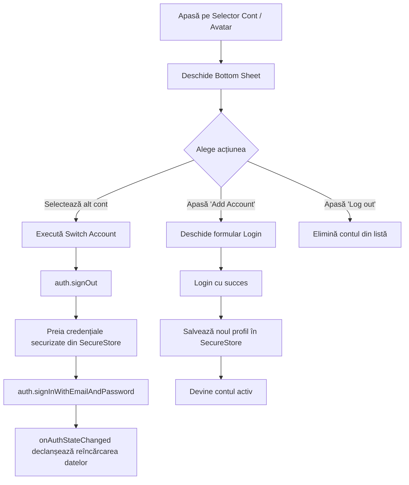

# Plan de Implementare: Multi-Account Authentication (Stil Instagram)

Acest document detaliază arhitectura, fluxul de lucru și pașii necesari pentru implementarea unui comutator de conturi multiple (Account Switcher) în aplicația MoneyTracker, similar cu funcționalitatea oferită de Instagram.

---

## 1. Obiective și Experiență Utilizator (UX)

1. **Păstrarea sesiunilor multiple**: Utilizatorul se poate conecta cu mai multe conturi pe același telefon.
2. **Comutare instantanee (Quick Switch)**: Trecerea de la un cont la altul (de ex. *Cont Personal* -> *Cont Business*) printr-un simplu tap, fără reintroducerea parolei.
3. **Meniu dedicat (Bottom Sheet)**:
   - Afișează avatarul, numele/email-ul și un indicator (bifat) pentru contul activ.
   - Buton **"Adaugă cont"** (`+ Add Account`) care deschide ecranul de login fără a deconecta conturile existente.
   - Opțiune de eliminare a unui cont specific sau deconectare globală (**"Deconectează toate conturile"**).
4. **Izolarea completă a datelor**:
   - Când se schimbă contul activ, toate datele (tranzacții, împrumuturi, obiective, statistici) se reîncarcă automat pentru noul `userId`.

---

## 2. Arhitectura Tehnică

### 2.1. Limitarea Firebase Auth și Soluția
În mod nativ, `@react-native-firebase/auth` păstrează o singură sesiune activă (`auth().currentUser`).
Pentru a permite mai multe conturi:
- Folosim un manager local de profiluri (`AccountManager`).
- Salvăm lista conturilor cunoscute și credențialele necesare re-autentificării automate în depozitul securizat al dispozitivului.

### 2.2. Securitate: `expo-secure-store`
Stocarea parolelor sau token-urilor **nu** se face în `AsyncStorage` simplu (nesecurizat), ci în **`expo-secure-store`**:
- **Android**: Folosește *Android Keystore* (criptare hardware AES).
- **iOS**: Folosește *iOS Keychain Services*.

Structura datelor stocate securizat:
```typescript
interface SavedAccount {
  uid: string;
  email: string;
  displayName?: string;
  photoURL?: string;
  lastUsed: number; // timestamp
}
```

Credențialele de re-login (criptate per UID):
- Cheie securizată: `secure_account_cred_${uid}` -> date de autentificare / refresh token.

---

## 3. Fluxurile de Lucru (Workflows)



### 3.1. Adăugarea unui cont nou
1. Utilizatorul apasă pe **"Add Account"** din meniu.
2. Este redirecționat către ecranul de Login/Register.
3. Se transmite un parametru (ex: `mode=add_account`), astfel încât sesiunea anterioară să fie salvată în siguranță în listă înainte de noul login.
4. După succesul `signIn`, profilul nou este adăugat în lista conturilor salvate.

### 3.2. Comutarea între conturi (Switch)
1. Utilizatorul atinge contul dorit din listă.
2. Aplicația apelează `auth().signOut()`.
3. Se preiau credențialele asociate din `expo-secure-store`.
4. Se apelează `signIn(email, password)` silențios în fundal.
5. Deoarece contextele (`TransactionsContext`, `LoansTab`, `GoalsTab`) ascultă deja `onAuthChanged`, acestea își resetează starea și încarcă automat documentele noului `userId`.

### 3.3. Deconectare (Log Out)
- **Log out of current account**: Se șterge doar contul activ din `SecureStore`, iar utilizatorul este comutat automat pe următorul cont rămas în listă (dacă există), sau trimis la Login (dacă era singurul).
- **Log out of all accounts**: Se curăță complet lista din `SecureStore` și se deloghează din Firebase.

---

## 4. Componente Necesare de Creat / Modificat

| Fișier | Rol |
| :--- | :--- |
| `utils/accountManager.ts` | Modul dedicat pentru salvarea, citirea, adăugarea și eliminarea conturilor din `expo-secure-store`. |
| `context/AccountContext.tsx` | Context React care expune: `savedAccounts`, `activeAccount`, `switchAccount()`, `addAccount()`, `removeAccount()`. |
| `components/AccountSwitcherSheet.tsx` | Componenta vizuală tip Bottom Sheet (lista de conturi, bife, buton add, buton logout). |
| `app/(tabs)/settings.tsx` | Adăugarea punctului de intrare în meniul de setări sau header (apăsare pe cont/profil). |
| `app/login.tsx` & `app/register.tsx` | Adaptare pentru a suporta adăugarea unui cont fără ștergerea conturilor salvate anterior. |

---

## 5. Pachete Recomandate
- `expo-secure-store` (pentru salvarea securizată a credențialelor în Keychain/Keystore):
  ```bash
  npx expo install expo-secure-store
  ```

---

## 6. Notițe & Considerații de Securitate
- Dacă utilizatorul își schimbă parola dintr-un cont pe un alt dispozitiv, la comutare pe telefonul actual `signIn` va returna eroare de parolă incorectă -> aplicația va cere reintroducerea parolei pentru acel cont specific.
- Datele din Firestore sunt complet izolate prin `userId`, astfel nu există risc de amestecare a tranzacțiilor între conturi.
