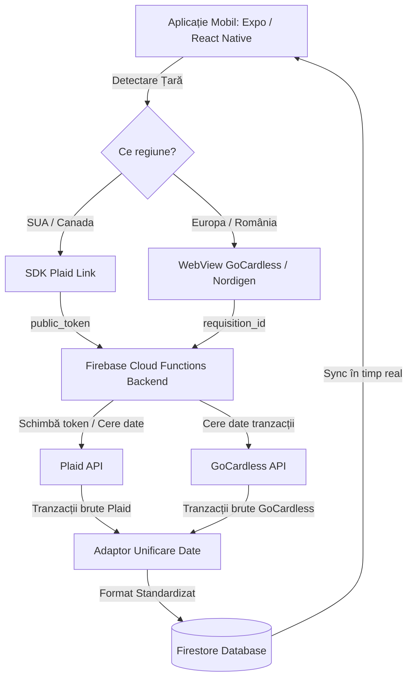

# Ghid Tehnic și Comercial: Open Banking & Monetizare pentru MoneyTracker

Acest document reprezintă un rezumat complet al discuției noastre privind citirea automată a tranzacțiilor de pe card și monetizarea aplicației pe piețele din SUA și Europa.

---

## 🗺️ 1. Arhitectura de Integrare (Globală)

Deoarece **SUA** este piața principală, dar dorești ca aplicația să funcționeze și în **Europa (inclusiv România)** fără costuri uriașe, arhitectura optimă folosește doi furnizori diferiți de Open Banking, unificați în backend:



> [!NOTE]
> **De ce această împărțire?** 
> * **Plaid** este lider incontestabil în SUA (compatibil cu Wise, Chase, BOA etc.) și are cea mai bună experiență de utilizare.
> * **GoCardless (Nordigen)** oferă acces la tranzacții în Europa (inclusiv toate băncile mari din România) **100% Gratuit**.

---

## 💰 2. Strategia de Monetizare și Profit

Pentru a acoperi costurile recurente de citire a datelor de la Plaid, este esențial să folosești un model de tip **Abonament (Subscription)**, nu o plată unică (Lifetime).

### Planul de Prețuri Recomandat
*   **Planul Free (Gratuit):** Introducere manuală a tranzacțiilor (ceea ce ai deja acum). Costul tău: **0$**.
*   **Planul PRO (Subscription):** Sincronizare bancară automată.
    *   **Lunar:** **4.99$ / lună**
    *   **Anual:** **29.99$ / an** (plata în avans asigură cash flow).

### 📊 Analiza de Costuri și Profit (Exemplu: Utilizator SUA cu 2 conturi active)
*   **Încasare brută abonament (Lunar):** $4.99
*   **Comision Store (Apple/Google 15%):** -$0.75
*   **Încasare netă (la tine în cont):** **$4.24**
*   **Cost Plaid (2 conturi active x $0.30):** -$0.60
*   **Cost Firebase / Server:** -$0.05
*   **PROFIT NET PER UTILIZATOR / LUNĂ:** **~$3.59** (Marjă de profit de **~85%**)

---

## 🛠️ 3. Ghid de Implementare Pas cu Pas

### Pasul A: Plățile în Aplicație (RevenueCat)
Pentru a nu scrie cod complex de StoreKit (iOS) și Google Play Billing (Android), folosește **RevenueCat**:
1. Creează cont pe [RevenueCat](https://www.revenuecat.com/).
2. Configurează abonamentele în **App Store Connect** și **Google Play Console**.
3. Adaugă produsele în portalul RevenueCat și instalezi SDK-ul în aplicație:
   ```bash
   npx expo install react-native-purchases
   ```
4. În aplicație, verifici starea abonamentului înainte de a permite conectarea băncii:
   ```typescript
   const customerInfo = await Purchases.getCustomerInfo();
   const isPro = customerInfo.entitlements.active["pro_access"];
   ```

### Pasul B: Integrarea Plaid (SUA)
1. Fă-ți cont pe [Plaid](https://plaid.com/) și obține cheile de API pentru modul **Sandbox** (testare) și apoi **Development**.
2. Instalează pachetul în aplicație:
   ```bash
   npx expo install react-native-plaid-link-sdk
   ```
3. În Firebase Cloud Functions, creează o funcție care generează un `link_token` temporar.
4. Deschide Plaid Link în aplicație folosind acest token. La finalizarea cu succes, vei primi un `public_token`.
5. Trimite `public_token`-ul către o altă funcție de backend Firebase pentru a-l schimba cu un `access_token` permanent, pe care îl salvezi în baza de date securizat.

### Pasul C: Integrarea GoCardless / Nordigen (Europa & România)
1. Fă-ți cont pe [GoCardless Bank Account Data](https://gocardless.com/bank-account-data/).
2. În modul de test, folosește banca lor fictivă (Sandbox/Fake Bank) pentru a simula acordul de citire al datelor (PSD2).
3. Utilizatorul va fi redirecționat într-un ecran securizat al băncii sale pentru autentificare (de exemplu, aplicația BT Pay sau Revolut), după care revine în aplicația ta.

### Pasul D: Unificarea Datelor în Firebase
Pentru a menține codul din aplicație simplu, structura tranzacțiilor stocate în Firestore trebuie să fie unică, indiferent de sursă:
```json
{
  "userId": "firebase_auth_uid",
  "amount": -14.99,
  "currency": "USD",
  "date": "2026-07-07T12:00:00Z",
  "description": "Netflix",
  "category": "Entertainment",
  "provider": "plaid", 
  "bankName": "Wise"
}
```

---

## 🚀 4. Recomandare pentru Testare (Cât timp ești în SUA)

Deoarece acum ești în SUA și ai doar un cont Wise:
1. **Testează Plaid** direct în **Sandbox** cu conturile fictive oferite de ei, sau folosește contul tău **Wise real** (Plaid are integrare nativă excelentă cu Wise).
2. **Testează GoCardless (pentru România)** folosind **Fake Bank** din sandbox-ul lor. Vei putea simula exact cum reacționează aplicația ta la tranzacții în **RON** și cu bănci românești fără a fi nevoie să fii fizic în țară sau să ai conturi active acolo acum.
3. Când te întorci în octombrie, poți doar să comuți API-urile din modul Sandbox/Development în modul de Producție.
